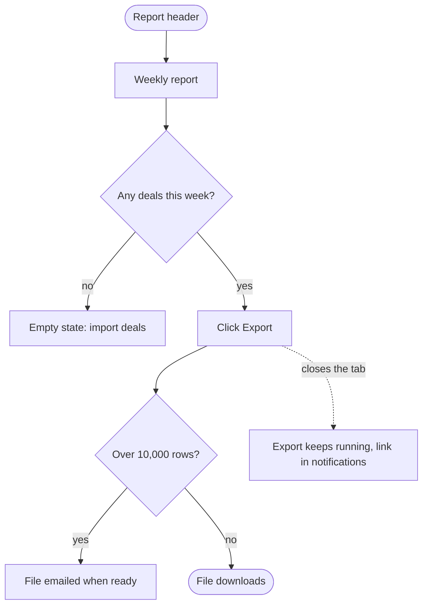

# UX Methods

The tables and reasoning behind each `ux-architecture` procedure step. Read only the section the current step needs.

## Information Architecture

Where the new thing lives, in the structure the user already has in their head.

Three questions, in order:

1. **Where does the user expect this to be?** Not where it is convenient to add it. If the answer differs from where it is easy, say so and name the cost of the easy option.
2. **What does it sit beside?** A feature placed next to unrelated things inherits their mental model and confuses both.
3. **What has to move?** Adding usually means reorganizing. A feature bolted onto a navigation that was full three features ago is how products become unusable one reasonable decision at a time.

Write the current structure and the proposed structure side by side. The diff is the deliverable, not the description.

## Flow Design

A flow is the path from intent to outcome. Specify it as ordered steps, each with the decision the user makes and what the system does in response.

| Element | Requirement |
|---------|-------------|
| **Entry points** | Every way in. A flow with one documented entry point and three real ones breaks at the undocumented two |
| **Steps** | The user's action and the system's response, per step |
| **Decision points** | Where the path branches, and what determines the branch |
| **Exit** | Success, abandonment, and what happens to partial work on abandonment |
| **Reversibility** | Which steps can be undone, and how |

The abandonment exit is the one that gets skipped. Every multi-step flow needs an answer to "they closed the tab at step 3": discard, save as draft, or resume. Silence here means the implementer picks, usually discard, usually wrong.

## Drawing the Flow

Each flow is drawn as well as tabled (gate 4.20). The drawing is where a missing exit or a branch that leads nowhere becomes visible at a glance, to the person accepting the spec as much as to the agent building it. It is written as Mermaid text inside `DESIGN.md`, next to its table: it needs no tool to write, renders on GitHub and in most editors and previews, and changes in a diff like any other line.

| Element | Drawn as |
|---------|----------|
| Entry point | a stadium node `([…])`, one per entry |
| User action or system response | a box `[…]`, named in the product's words, the same words as the table |
| Decision point | a diamond `{…?}`, its exits labeled with the answer |
| Success exit | a stadium node at the end |
| Abandonment | a dotted arrow `-.->` to what happens to partial work |
| Error and empty | boxes off the decision that leads to them, named after their state in `## States` |

The table and the drawing say the same thing; when they disagree, the table is fixed first, because the spec and the tests read it, and the drawing follows. **The person edits the drawing by hand.** `node scripts/bos.mjs flows` writes `design/flows.html` in the initiative, at no model cost: each flowchart opens on a hand-drawn canvas (Excalidraw, MIT, laid out by its Mermaid importer) where the person drags boxes, adds one, joins two with an arrow, renames by double-click and dashes an abandonment arrow; the page turns the drawing back into the flowchart as they go. A Text tab shows the same Mermaid beside its drawing (Pele, Mermaid to SVG), with parse errors in place; state diagrams are edited there. Libraries load pinned from a CDN; offline the text stays editable. They copy or save their changes, and `bos.mjs flows --apply flows-edited.md` writes only the edited blocks back into `DESIGN.md`; the agent then brings each table in line with its drawing, reading a few lines rather than the canvas. Open the page with the person when the flows are first drawn and whenever they want to change one. Another canvas (`diagram.render`: tldraw, FigJam, …) can serve a workshop the same way: what changes there comes back into the Mermaid block and the table, which stay the record.

A lifecycle is drawn the same way, as a `stateDiagram-v2` under its transitions table in `## Domain model` (`domain-model`, step 2).

## State Coverage

Six states per step. Gate 4.3 enforces two of them; the other four are how a feature stops feeling unfinished.

| State | What it needs |
|-------|--------------|
| **Empty** | What a new user sees, and the one action that fills it. An empty state with no action is a dead end |
| **Loading** | The indication, and what happens if it takes longer than expected. A spinner with no timeout is a hang |
| **Partial** | Some of it worked. What is shown, what is retryable, what was lost |
| **Error** | What happened in the user's words, whose problem it is, and the next action. Never a code alone |
| **Success** | Confirmation that is visible without hunting, and the next step |
| **Permission** | Preserve the application’s actual authorization contract: sign-in redirect, 401, 403 or a deliberate 404 that conceals resource existence. Design recovery only where disclosure is permitted; do not reveal hidden resources |

Error copy is part of the architecture, not a polish task. "Something went wrong" tells a user nothing and generates a support ticket. Name what failed, and what they can do.

## Component Inventory

What this feature needs, split three ways:

| Category | Meaning | Consequence |
|----------|---------|------------|
| **Exists** | Already in the system, used as is | Free, and consistent |
| **Exists, needs extension** | A new variant, size or state on an existing component | Cheap, but it changes every other use of that component. Say so |
| **New** | Nothing like it exists | Expensive. Each one is a maintenance obligation, so justify it |

A feature that needs four new components is usually a feature that ignored the system. Look again before accepting that count: the third question is whether the interaction is genuinely new, or whether it is an existing pattern in an unfamiliar arrangement.

## Accessibility Floor

Gate 4.5 requires the floor stated, not audited. Three things, specified before building, because retrofitting each one is an order of magnitude more expensive:

| Element | The requirement |
|---------|----------------|
| **Keyboard path** | Every action reachable and completable without a pointer, in a sensible order. Name the tab order for the primary flow |
| **Contrast target** | The standard being held to, stated as a ratio, for text and for meaningful non-text |
| **Focus order** | Where focus goes on open, on close, on error, and on completion. Focus lost to the body element after a dialog closes is the most common failure |

Beyond the floor, three more that cost nothing when designed in: every control has an accessible name, state changes are announced rather than only shown, and no information is carried by color alone.

The floor is a floor. A full audit belongs to a dedicated accessibility pass; stating these three prevents the failures that are structural rather than cosmetic.

## Interop

The visual layer (typography, spacing, colour, motion, the design kit) belongs to `design-direction`, which renders versions for the user to choose from and writes the tokens into `DESIGN.md`. Where a design-quality toolchain is present it renders through it; where none is, it writes HTML files. This skill keeps information architecture, flows, states, the component inventory and the accessibility floor; the component inventory names components of the kit `design-direction` settles.

## More Common Mistakes

| Mistake | Why it fails | Correct |
|---------|-------------|---------|
| An empty state with no action | A dead end for every new user | One clear action that fills it |
| One documented entry point, three real ones | The flow breaks at the undocumented two | Enumerate every entry |
| Accessibility as a later pass | Keyboard and focus are structural, not cosmetic | State the floor before building |
| Information carried by color alone | Invisible to a meaningful share of users | Pair color with text or shape |
| Placing the feature where it is easy to add | The navigation degrades one reasonable decision at a time | Place it where the user expects it, or name the cost |
| Designing the happy path only | Partial and permission states are where the support load comes from | Six states per step |
| "Something went wrong" | Tells the user nothing, generates a ticket | Name what failed and the next action |
| No abandonment behavior | The implementer picks, usually discard | Specify discard, draft or resume |
