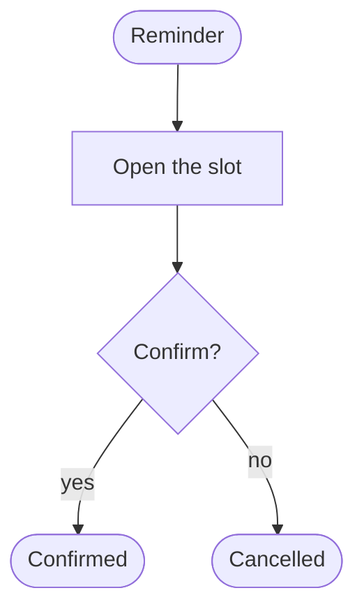
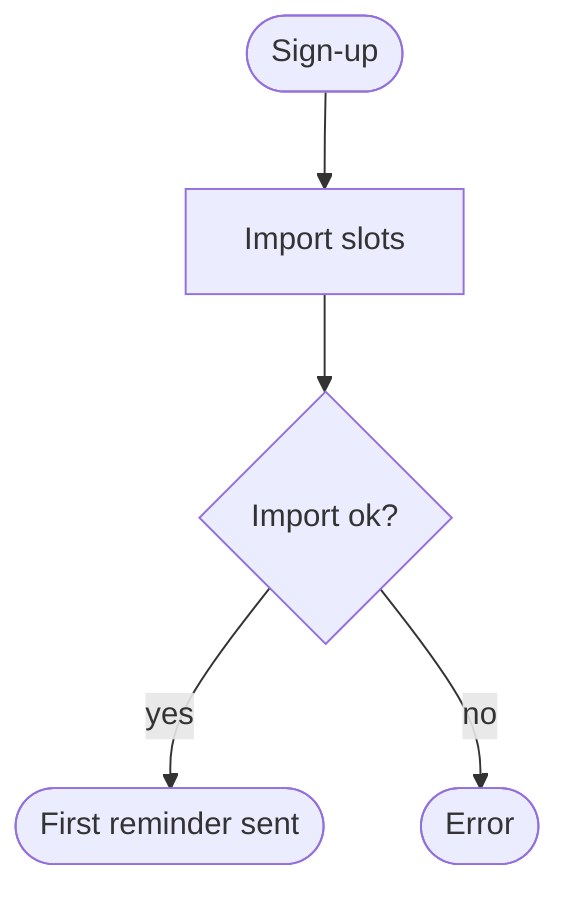
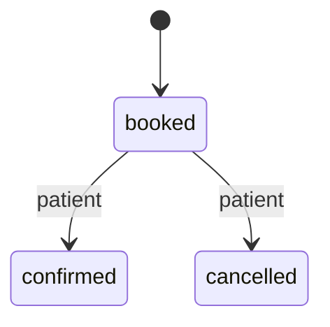

# Design — Promemoria

## Placement
**Today:** nothing
**Proposed:** one web app for the clinic
**Moves:** none

## Flows
### Confirm a slot
**Entry points:** the reminder message
| Step | User action | System response | Branches |
|------|-------------|-----------------|----------|
| 1 | Patient opens the reminder | shows the slot | confirm or cancel |
| 2 | Patient confirms | marks the slot confirmed | none |

**Abandonment:** nothing is saved
**Reversible:** cancel until 24 hours before

### First day
**Entry points:** the sign-up link
| Step | User action | System response | Branches |
|------|-------------|-----------------|----------|
| 1 | Owner signs up | shows sample week | none |
| 2 | Owner imports slots | sends first reminder | import fails |

## States
| Flow / step | Empty | Loading | Partial | Error | Success | Permission |
|-------------|-------|---------|---------|-------|---------|------------|
| Confirm a slot | no slot | spinner | n/a | slot gone | confirmed | wrong link |
| First day | sample week | spinner | half imported | import failed | first reminder | n/a |

**Error copy:** "This appointment no longer exists."

## Messages
| Message | Trigger | Recipient | Channel | Text | Opt-out | Preview |
|---------|---------|-----------|---------|------|---------|---------|
| Reminder | 24 hours before the slot | patient | WhatsApp | Domani alle 10 hai fisioterapia: confermi? | reply STOP | design/messages/reminder.md |

## Components
| Component | Exists / Extend / New | Affects | Justification (new only) |
|-----------|----------------------|---------|--------------------------|
| Slot list | New | owner | first screen |

## Accessibility floor
**Keyboard path:** confirm, cancel
**Contrast:** 4.5:1
**Focus:** on open the slot · on close the list · on error the message · on completion the status

## Domain model
### Entities
| Entity | Means | Lifecycle |
|--------|-------|-----------|
| Slot | one booked hour | yes |

### Transitions: Slot
| From | To | Who | Only if | Then |
|------|----|-----|---------|------|
| booked | confirmed | patient | before start | notify owner |
| booked | cancelled | patient | 24 hours before | free slot |

### Invariants
- A slot belongs to one clinic.

### Data
| Entity | Key fields | Relations | Deleted with |
|--------|-----------|-----------|--------------|
| Slot | time, patient phone | clinic | clinic |

**Rules decided by:** Mario
**Prototype:** design/domain-prototype.html

## Visual direction
**References:** design/refs/r1.png, design/refs/r2.png, design/refs/r3.png
| Version | Axis and direction | File | Avoids | Verdict |
|---------|--------------------|------|--------|---------|
| A | calm list | design/a-v1.html | generic dashboard | chosen |
| B | calendar | design/b-v1.html | generic dashboard | rejected: busy |
| C | cards | design/c-v1.html | generic dashboard | rejected: loose |

**Chosen:** A, design/a-v1.html
**Chosen by:** Mario
**Why:** calm
**Design kit:** shadcn · **Alternatives:** none
**Tokens:**
| Token group | Values |
|-------------|--------|
| Colour roles | text: #111 (15:1) |
| Type | Inter |
| Spacing | 4px |
| Shape | 8px |
| Elevation | none |
| Motion | 150ms |

**Composition:** one column
